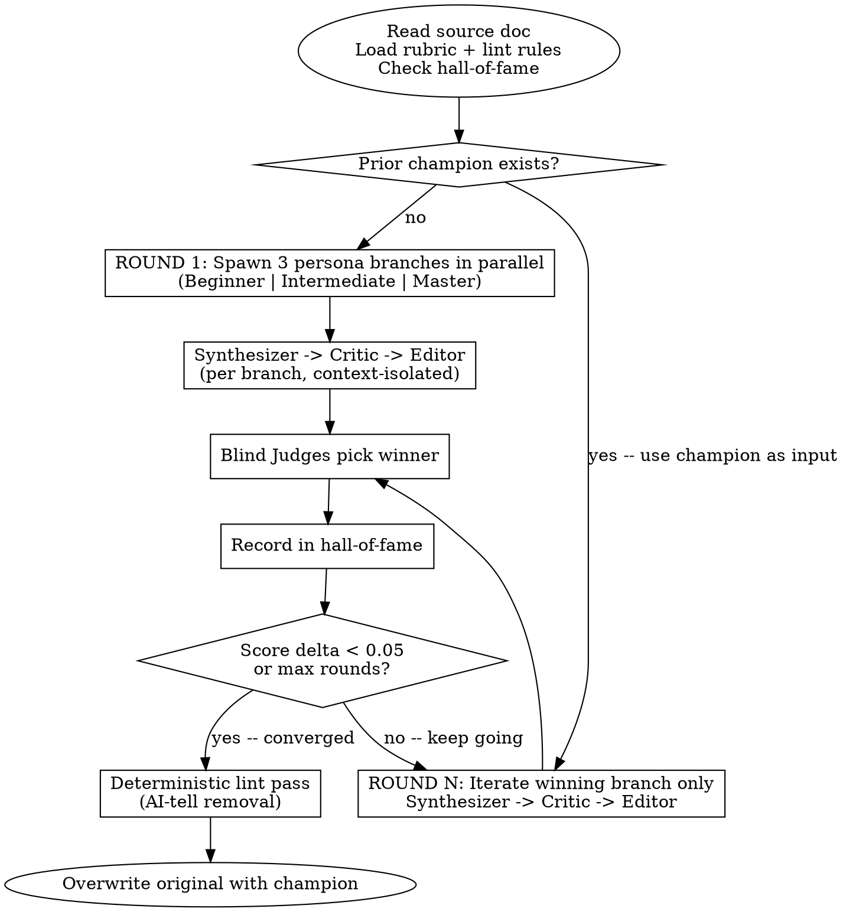

# ARESE -- Adversarial Reader-Empathy Synthesis Engine

## Overview

Recursive multi-agent framework that rewrites documents for the reader, not the author. Siloed agent roles (no shared context between them) eliminate sycophancy. Hall-of-fame archiving guarantees monotonic improvement. Stops when the score stops climbing.

**Core principle:** Every sentence must earn its place. If a reader wouldn't miss it, cut it.

## When to Use

- "Improve this document" / "tighten this up" / "make this better"
- Synthesizing multiple sources into a cohesive narrative
- Rewriting technical content for a specific audience
- Any writing where "good enough" isn't

**When NOT to use:** Code, config files, structured data, quick edits to a single sentence.

## Input

Accept **file path** (`/arese docs/my-doc.md`) or **IDE selection** (highlight text, run `/arese`). If neither, ask.

Optional flags:

| Flag | Default | Description |
|------|---------|-------------|
| `--max-rounds` | 6 | Maximum revision rounds |
| `--quick` | false | Cap at 2 rounds |
| `--persona` | all | Target: `beginner`, `intermediate`, `master`, or `all` |
| `--fresh` | false | Ignore existing hall-of-fame, start over |
| `--dry-run` | false | Run full loop but don't overwrite original |

## Orchestration Flow



## Agent Roles

**CRITICAL: Agents share NO context between roles. The Critic never sees the Synthesizer's reasoning or the source doc. This is how sycophancy is eliminated.**

### 1. Persona Agent (Round 1 only)

Creates 3 parallel composition branches:

| Persona | Knowledge Level | Pain Point | Writing Strategy |
|---------|----------------|------------|-----------------|
| **Beginner** | Minimal domain knowledge | Overwhelmed by jargon | Progressive disclosure, define terms inline |
| **Intermediate** | Working knowledge | Buried insights | Lead with what's new/different |
| **Master** | Deep expertise | Time wasted on basics | Maximum density, skip fundamentals |

### 2. Synthesizer (per branch)

**Model**: sonnet | **Receives**: Source doc + persona definition + prior champion (if resuming)

> Produce a candidate narrative optimized for the target persona. Every sentence must earn its place. No filler. No hedging. No throat-clearing. Lead with the most important thing the reader needs to know.

**Output**: Candidate narrative only.

### 3. Adversarial Critic (per branch)

**Model**: opus | **Receives**: Candidate narrative ONLY (never the source doc or Synthesizer reasoning)

> You are a hostile reader with no patience. For every paragraph:
> - What claim is unsupported?
> - What's vague where it should be specific?
> - What sentence adds nothing?
> - What would make a skeptical reader stop reading?
>
> Propose specific line-level revisions. Be ruthless. "What else is possible?" for every choice the author made.

**Output**: Line-level revision proposals with rationale.

### 4. Editor (per branch)

**Model**: opus | **Receives**: Original source + candidate + Critic proposals + WQRM rubric

> Evaluate each Critic proposal against the WQRM rubric. Accept proposals that improve scores. Reject those that don't. Produce the revised narrative with a score breakdown across all three WQRM categories plus authenticity multiplier.

**Output**: Revised narrative + WQRM scores `{information_density, evidence_quality, reader_influence, authenticity, total}`.

### 5. Blind Judges (end of each round)

**Model**: opus | **Receives**: All candidate outputs (anonymized -- no branch labels, no scores) + WQRM rubric

> Rank these candidates purely on reader empathy. Which one would the target reader choose to keep reading? Which one respects their time? Explain your ranking.

**Output**: Ranking + rationale + winning candidate selected as champion.

## Scoring

Three categories (1-10) with weights:
1. **Information Density** (0.35) -- insight per word
2. **Evidence Quality** (0.35) -- specificity, verifiability
3. **Reader Influence** (0.30) -- persuasion efficiency, clear call-to-action

**Authenticity multiplier** (0.80-1.10): penalizes AI-sounding prose, rewards distinctive voice.

`total = (density x 0.35 + evidence x 0.35 + influence x 0.30) x authenticity`

## Default Rubric

```
## Information Density (weight: 0.35)
1-3: Padding, repetition, filler. Reader learns little per paragraph.
4-6: Adequate. Some filler. Key points present but buried.
7-8: Tight. Every paragraph advances understanding. Minimal waste.
9-10: Maximum compression without sacrificing clarity. Nothing to cut.

## Evidence Quality (weight: 0.35)
1-3: Vague claims, no data, hand-waving.
4-6: Some specifics but unverifiable or tangential.
7-8: Concrete data, named sources, relevant examples. Checkable.
9-10: Every claim grounded. Evidence directly supports argument.

## Reader Influence (weight: 0.30)
1-3: Reader doesn't know what to do or think after reading.
4-6: Direction present but buried. Reader has to work to find the point.
7-8: Clear thesis, logical flow, actionable conclusion.
9-10: Compelling arc. Reader is moved to act. Opening hooks, closing lands.

## Authenticity Multiplier (0.80-1.10)
0.80-0.90: Heavy AI patterns. "Delve", "crucial", hedging everywhere.
0.91-1.00: Some AI tells. Mostly clean but occasionally robotic.
1.01-1.05: Natural voice. Reads like a human expert.
1.06-1.10: Distinctive voice. Stylistic choices AI wouldn't make.
```

## Convergence

- Stop when score delta < 0.05 between consecutive rounds
- Stop at `--max-rounds` (default 6)
- If round 1 scores > 9.5 across all categories, skip to lint pass

## Hall-of-Fame

**Location**: `~/.claude/arese/hall-of-fame/<doc-hash>/`

| File | Purpose |
|------|---------|
| `results.tsv` | `iteration \| branch \| score \| authenticity \| status \| summary` |
| `champion.md` | Current best version |
| `source.md` | Original input (for diff comparison) |

`<doc-hash>` = MD5 of absolute file path (not content -- so edits between runs don't create new entries).

**Resume**: If hall-of-fame exists for this document and `--fresh` is not set, start from the last champion. Report: "Resuming from round N (score X.XX)."

## Lint Pass

The lint pass is **deterministic** (regex/string matching), not LLM-based. AI tells survive adversarial review because agents don't notice their own patterns. The lint pass catches what they can't.

Create a `lint-rules.yml` in `~/.claude/arese/` with patterns to flag. For each match:
1. Flag the sentence
2. Rewrite to eliminate the pattern while preserving meaning
3. Log what was changed

## First-Run Bootstrap

If `~/.claude/arese/` doesn't exist when `/arese` is invoked:
1. Create `~/.claude/arese/`
2. Create `~/.claude/arese/hall-of-fame/`
3. Write default `rubric.md` and `lint-rules.yml` from the embedded defaults above
4. Inform user: "First run -- created config at ~/.claude/arese/. Edit rubric.md and lint-rules.yml to customize scoring."

## Common Mistakes

| Mistake | Why It Breaks Things |
|---------|---------------------|
| Sharing context between Critic and Synthesizer | Critic becomes sycophantic -- agrees with reasoning it can see |
| Stopping after round 1 | Multi-persona comparison is the most valuable step. Iterate. |
| Skipping lint pass | AI tells survive adversarial review. Lint is the safety net. |
| Using `--fresh` habitually | Throws away prior progress. Only use when the document has been substantially rewritten by hand. |
| Editing rubric mid-run | Scores become incomparable. Edit between runs, not during. |
